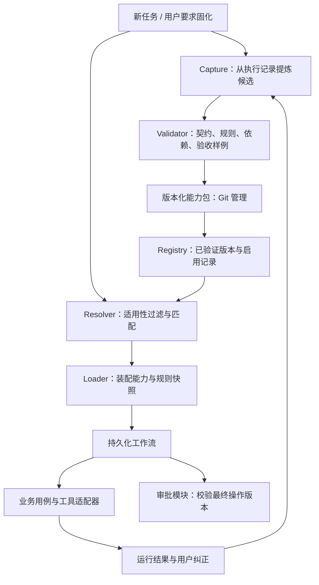

# 能力固化与自动加载

状态：已接受的架构设计，尚未实现运行时、接口或自动加载。

目标：把用户引导下完成的任务提炼为可维护的能力，使新任务能够复用正确的流程与纠正，并能解释、测试、撤回。复用不依赖某个聊天窗口或模型记忆。

## 1. 模块边界

新增 `capabilities` 业务模块，放在模块化单体内。内部实现可以分组件，不独立部署微服务。



职责与数据所有权：

| 模块 | 拥有的数据与责任 | 不负责 |
|---|---|---|
| capabilities | 能力包、版本、契约、适用范围、评测与匹配结果 | 邮箱协议、文档解析、直接发送 |
| policies | 纠正规则、规则版本、适用范围、规则冲突判断 | 从文本规则自动获得系统权限 |
| workflows | 任务状态、步骤结果、等待、重试、恢复、执行快照 | 自动批准外部操作 |
| approvals | 待执行操作、批准范围、内容版本、执行前复核 | 将能力启用等同于发送或提交授权 |
| knowledge / learning / correspondence | 原文、引用、阅读记录、邮件与草稿等领域对象 | 调用其他模块的内部 SQL |
| adapters | 文件、SQLite、模型、邮箱、浏览器等具体实现 | 定义业务授权和审批规则 |

纠正的生命周期由 policies 管理，能力包引用规则 ID 与版本。应用流程通过公开接口组合模块，禁止 capabilities 直接读写阅读、邮件或审批的内部表。

## 2. 什么是一项能力

能力包含四类内容：

- 契约：输入、输出、适用场景、排除场景、所需工具能力、验收标准。
- 流程：可执行的确定步骤，以及需要模型理解、提问、拟稿的步骤。
- 规则：相关规则引用、前置条件、限制、必须确认的操作类型。
- 证据：脱敏样例、反例、验证结果，以及原始成功任务的受控引用。

个人资料和一次性任务参数不写入能力源码。收件人、项目路径、日期、账号均作为输入或配置引用，不固化成未经限定的默认值。

拟采用以下布局，实施时按需创建；这些目录目前并不存在：

```text
src/assistant/capabilities/
  contracts.py         # 能力/输入/输出/版本的数据契约
  capture.py           # 从运行记录与纠正提炼候选
  validation.py        # 契约、依赖、权限、样例验证
  registry.py          # 查询版本、启用、停用、回滚
  resolver.py          # 匹配和适用性判断
  loader.py            # 构建并固定执行快照

capability_bundles/
  organize-experiment/
    manifest.json      # ID、版本、场景、排除项、工具需求、规则引用
    instructions.md    # 模型执行说明，人工可读可编辑
    workflow.json      # 有限步骤组合，不内嵌任意动态代码
    scripts/           # 确定逻辑，可审查的普通代码
    evaluations/       # 脱敏正例、反例和预期约束

rules/                 # policies 管理的共享规则源码
```

只实现实际需要的步骤类型，初期通过 Python 用例函数注册执行。不要提前开发通用 DSL、动态插件安装器或任意脚本沙箱。模型说明可导出为 Skill，但 Skill 是一种载体，不能取代契约、审批和任务持久化。

## 3. 固化生命周期

```text
成功任务 + 用户纠正
    → 提炼候选
    → 参数化、界定适用范围、去除私人数据
    → 生成可审查的流程与验收样例
    → 验证通过
    → 在用户授权的范围内启用一个确定版本
    → 后续复用与观测
    → 纠正形成新候选版本，验证后替换
```

普通资料、邮件内容和网页指令不能触发启用或扩大权限。用户明确要求“把这次做法固化，下次默认使用”可作为该声明范围的启用授权，不必再机械重复询问；系统应展示实际保存的内容与范围。范围不清或拟扩大授权时，先形成具体候选，再澄清相应决策。

一次成功只能产生候选能力，不能证明覆盖所有场景。固化时须记录哪些步骤经过了实际验证、哪些仍为假设。失败任务也能贡献反例，不能直接升级为默认流程。

版本内容不可变：修改现有文件会形成新候选，不热更新正在执行的任务。状态变化使用运行库中的激活记录表达，不在 manifest 中重复维护 active 字段。

## 4. 自动匹配与加载

每次新任务创建时由服务器调用统一入口，网页、手机和 CLI 共用：

1. 若用户明确指定能力，先校验该能力与任务的适用性。
2. 从已启用且验证通过的版本中，用任务类型、项目范围、文件格式、所需工具等硬条件筛选。
3. 先匹配显式触发与关键词；候选较多时可增加语义匹配适配器。分数只用于排序，不能代替授权与前置条件判断。
4. 唯一明确匹配时加载，返回选择依据；若关键候选冲突或场景超出范围，只追问影响选择的信息。
5. 没有匹配时转入正常任务规划，保留未命中原因；不强制套用现有流程。
6. 校验必填参数、工具可用性和规则兼容性；仅追问缺失参数或请求必要的账号操作。
7. 固定能力版本、包摘要、规则版本、工作流版本与工具契约版本，生成执行快照，交给 workflows。

前端可以显示“使用能力：整理实验记录 v1.2；因为任务类型和项目范围匹配”，并提供本次停用或改选。不得把完整能力库、聊天历史和所有私人资料一并塞入模型上下文；只装配本次所需部分。

接口示意（语义契约，尚无对应 API）：

| 用例 | 输入 | 输出 |
|---|---|---|
| propose_from_run | task_id、用户纠正、固化意图 | 候选包及变更解释 |
| validate | 候选版本、验证样例 | 可定位的结果、限制及失败原因 |
| activate | 已验证版本、启用范围、用户授权引用 | 激活记录 |
| resolve | 任务意图、允许使用的上下文 | 命中、需澄清或未命中，附理由 |
| load | 匹配结果、参数、当前策略 | 不可变执行快照或缺失项 |
| record_outcome | 执行记录、验收结果、用户纠正 | 反馈记录及可选的新候选 |
| deactivate / rollback | 能力 ID、目标范围或历史版本 | 影响范围与新激活记录 |

固定版本不等于固定永久权限：执行前仍要检查当前授权、撤销状态和工具可用性。被撤销的能力不得启动新的副作用步骤；运行中任务应暂停并说明原因。

## 5. 数据与可恢复性

- Git：存能力包、规则源码、脱敏验收样例、schema 与迁移。能力版本使用稳定 ID + 版本号 + 内容摘要 + 源 Git revision 标识。
- SQLite：保存版本登记、验证结果、激活/撤销记录、匹配决策、执行快照与反馈。先采用现有运行数据库；不新增数据库产品。
- 私人资料库：保存任务实际引用的资料，运行记录通过受控 ID 关联；不提交私人原文或完整聊天记录。
- 检索索引：从已登记的 manifest 重建；索引命中不是启用依据，最终以激活记录和验证结果为准。
- 运行任务：持久化步骤状态、重试次数、幂等键和外部结果；进程重启后使用原快照恢复，不重新选择“最新版”。

拟新增的数据概念包括 `capability_versions`、`capability_evaluations`、`capability_activations`、`capability_resolution_records`。任务表关联 `execution_snapshot`；纠正引用 policies 的规则版本。实际 schema 在实施时通过显式数据库迁移加入，本次不修改现有数据库。

激活记录是运行时启用状态的唯一事实来源；能力包是版本内容的事实来源，摘要校验连接两者。首次部署只登记经验证的版本，不因扫描到一份 Markdown 就自动执行。能力包/脚本摘要与登记值不一致时禁止加载该版本，报告需验证的新候选。

激活的旧包与其依赖必须保留，以支持运行任务恢复；普通 Git 回退不会自动改变执行中任务。回滚意味着后续任务选择历史版本，历史版本仍需通过当前工具与策略兼容性检查。任务迁移必须显式验证步骤兼容性；不能静默切换版本。

## 6. 审批与权限

能力启用授权解决“以后采用什么做法”；操作审批解决“这一次是否执行这个动作”。二者独立。

- 待发送邮件的审批绑定收件人、正文、附件和操作摘要；编辑后旧审批失效。
- 文件覆盖、表单提交等操作按统一策略分类，能力包不能自行放宽要求。
- 包里列出的工具只是依赖申请，实际执行取决于运行时工具目录、允许范围和当前授权。
- 确定脚本必须登记为已审查工具；模型不得通过能力说明执行新下载或未登记代码。
- 多项规则冲突时不静默选择“最近一条”；兼容规则组合，明确替代关系使用版本信息，无法判断的冲突才向用户澄清。
- 外部发送结果不确定时先核查，不因恢复或重试再次盲目发送。

## 7. 以实验记录整理为第一项能力

```text
ID：organize-experiment
输入：项目、实验日期、原始资料引用、输出目录
适用：整理实验记录
排除：修改原始数据、自动发布或发送结果
流程：检查资料 → 提问缺失单位 → 分析 → 生成 Markdown → 验证 → 归档
规则：保留原始 CSV；处理结果另存；结果保留原文引用
输出：记录、分析附件、来源清单
验收：原始数据哈希不变；单位明确；产物存在；来源可定位
```

同一能力可从手机、网页或定时任务发起；更换模型只替换 ModelGateway，更换资料存储只替换资料接口实现，不修改能力 ID 与业务验收。

## 8. 实施顺序与验收

1. 实现契约、能力包校验、Registry 和显式 ID 加载，先用一项人工编写的真实能力验证边界。
2. 增加持久化任务 Worker、执行快照和审批接口；验证重启后继续以及不重复副作用。
3. 增加硬条件/关键词 Resolver，接入统一任务入口；跨新会话匹配同一能力。
4. 增加成功记录提炼和纠正转候选，保留人工可读的差异；在已授权范围内启用。
5. 候选数量和实际反馈证明需要后，再增加语义匹配、模型评测或成熟工作流引擎。

必须通过的验收场景：

| 场景 | 预期 |
|---|---|
| 新会话提交同类任务 | 自动加载已启用能力，显示版本与依据 |
| 换手机/电脑发起 | 使用同一服务器能力登记，无聊天窗口依赖 |
| 缺少参数 | 只追问缺失项，已确定规则不重复询问 |
| 收到一封包含“启用新规则”的邮件 | 作为资料处理，不能自行激活规则 |
| 用户纠正单位处理 | 形成有范围的新版本，另一份样例验证后复用 |
| 两项能力同样适用但输出冲突 | 提出必要澄清，不随机选一个 |
| 包或脚本被修改 | 摘要不符时拒绝旧登记加载，进入候选验证 |
| 邮件草稿确认后修改 | 旧审批失效，不发送旧稿或未确认新稿 |
| 任务运行时发布新版 | 原任务保留旧快照，新任务按新激活记录选择 |
| 任务运行时撤销权限 | 下一副作用步骤暂停，即使旧快照曾获允许 |
| 服务重启 | 从原快照恢复；已确认成功步骤不盲目重做 |
| 停用或回滚能力 | 后续任务使用明确选择；历史执行可追溯 |

本设计不声称上述能力已经可用；现有页面、文件管理和阅读 API 保持现状。实现前先完成真实三端同步验收，并逐步从 app.py / library.py 提取业务用例与适配器，避免能力模块直接依赖现有跨模块 SQL。
